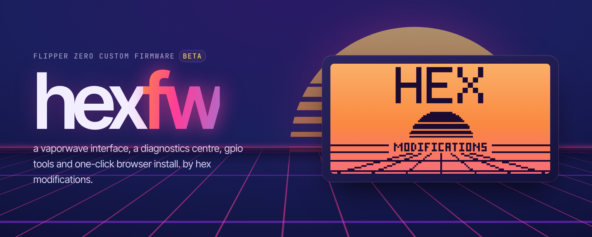
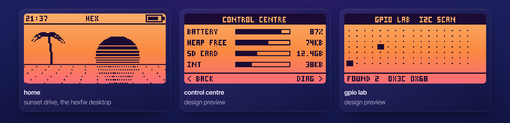

<p align="center">
  <a href="https://hex-modifications.github.io/flipper/"></a>
</p>

<h3 align="center">A vaporwave custom firmware for Flipper Zero, with a one-click installer in your browser.</h3>

<p align="center">
  <a href="https://hex-modifications.github.io/flipper/#download"></a>
  <a href="downloads/v0.1.0-beta.1"></a>
  
  
</p>

<p align="center">
  <a href="https://hex-modifications.github.io/flipper/#download"><b>⚡ Install</b></a> ·
  <a href="downloads/v0.1.0-beta.1"><b>⬇ Download</b></a> ·
  <a href="https://hex-modifications.github.io/flipper/">Website</a> ·
  <a href="#install">Install guide</a> ·
  <a href="#faq">FAQ</a> ·
  <a href="https://hex-modifications.github.io/flipper/#pro"><b>✦ Pro</b></a> ·
  <a href="#support-hexfw">Donate</a> ·
  <a href="https://github.com/001Hex/hexfw-releases/issues">Report a problem</a>
</p>

---

**HexFW** is a custom firmware (CFW) for the **Flipper Zero** by **Hex Modifications**. It gives your Flipper a retro-futurist look built from hand-drawn 1-bit pixel art (striped suns, grid horizons and palm silhouettes) while staying close to the official firmware, so it stays stable, fast and compatible with the apps you already use.

Install it from your browser in about two minutes: plug in your Flipper, press **Install to Flipper** on [the HexFW page](https://hex-modifications.github.io/flipper/#download), done. No qFlipper, no drivers, no SD card shuffling.

<p align="center">
  
</p>

## What's in it

| | |
|---|---|
| **Vaporwave desktop** | Two original idle scenes replace the stock animations: *Sunset Drive* (palm, striped sun, shimmering sea) and *Grid Run* (the HEX mark over a scrolling neon grid). |
| **One-click web installer** | Flash HexFW straight from [hex-modifications.github.io/flipper](https://hex-modifications.github.io/flipper/#download) in Chrome or Edge. It uses the same USB protocol as qFlipper and verifies the SHA-256 of every download. |
| **App compatible** | Built on the official Flipper Zero firmware 1.5.1 with the same app API, so apps from the official catalogue and the Flipper mobile app keep working. |
| **Easy to leave** | Going back to official firmware is a normal update. Your SD card files are never touched. |

**On the way** (shown as design previews): Control Centre (battery health, memory, storage), hardware diagnostics, GPIO Lab (I²C scanner, UART terminal, PWM), customisable dashboard and menus, profiles, an app compatibility checker and a beginner-friendly *Learn* mode. See the [roadmap on the website](https://hex-modifications.github.io/flipper/#features).

> **Beta.** `v0.1.0-beta.1` has not yet been tested on physical hardware by Hex Modifications. It's the official 1.5.1 firmware plus the HexFW desktop, and the Flipper's own updater checks every file before it writes anything. If anything goes wrong, the [recovery steps](#recovery) put you back on official firmware.

## Install

**1. In your browser (easiest).** On a computer with Chrome, Edge or Opera:

1. Plug your Flipper Zero in with a USB cable that carries data. Unlock it and go to the desktop. Close qFlipper.
2. Open **[hex-modifications.github.io/flipper](https://hex-modifications.github.io/flipper/#download)** and press **Install to Flipper**.
3. Pick your Flipper in the pop-up. The page copies the update to the SD card and the Flipper installs it, which takes about two minutes. Leave it plugged in until it restarts.

**2. With Flipper Lab.** Press **Install with Flipper Lab** on the same page. It opens lab.flipper.net with HexFW preselected.

**3. With qFlipper.** Download `flipper-z-f7-update-<version>.tgz` from [the downloads folder](downloads/v0.1.0-beta.1) (click the file, then **Download raw file**), open qFlipper, connect your Flipper and choose **Install from file**.

**4. From the SD card.** Extract the `.tgz` and copy the `f7-update-<version>` folder to `/update` on the SD card. On the Flipper, open **Archive**, go to that folder, select `update` and choose **Run in App**.

### Verify your download

Every release folder includes `SHA256SUMS`. Compare it with:

```bash
shasum -a 256 flipper-z-f7-update-*.tgz          # macOS
sha256sum flipper-z-f7-update-*.tgz              # Linux
Get-FileHash .\flipper-z-f7-update-*.tgz         # Windows PowerShell
```

The web installer does this check for you automatically.

## Recovery

- **Back to official firmware:** install the official release with qFlipper or [lab.flipper.net](https://lab.flipper.net) like any update. Your SD card stays as it is.
- **Frozen Flipper:** hold **Left + Back** for a couple of seconds, then let go.
- **Won't boot:** hold **Left + Back**, release **Back**, keep holding **Left** until the LED turns blue and the DFU screen appears. Connect qFlipper and choose **Repair**.

## FAQ

**Is HexFW free?** Yes. If you enjoy it, [a tip](#support-hexfw) helps fund new features and test hardware.

**Will my apps still work?** Yes. HexFW keeps the official firmware's app API (88.x), so catalogue apps built for official firmware load normally.

**Will I lose my saved signals, cards or keys?** No. They live on the SD card, which the update doesn't touch, and internal settings are backed up and restored by the updater.

**Which browsers support the web installer?** Desktop Chrome, Edge and Opera (Web Serial). Safari and Firefox don't support USB serial: use Flipper Lab or qFlipper instead.

**Does HexFW unlock extra radio frequencies?** No. HexFW keeps the official regional transmit limits. Use radio features legally and only on devices you own or are authorised to test.

**Is this made by Flipper Devices?** No. HexFW is an independent project by Hex Modifications, built on the official Flipper Zero firmware, and is not affiliated with or endorsed by Flipper Devices Inc.

## HexFW Pro

<p align="center"><a href="https://hex-modifications.github.io/flipper/#pro"></a></p>

**HexFW Pro** adds a toolkit of practical apps you won't find on any other Flipper: **Logic Lab** (a 4-channel logic analyser with I²C, SPI and UART decoding), **Signal Vault** (organise and PIN-encrypt your saved signals), a **Sensor Dashboard** with live graphs and CSV logging, **Routines**, a receive-only **Spectrum Scope**, **Remote Studio**, **Battery Lab** and **Theme Studio**. It's £10 one-off, one licence per Flipper, installed in one click from the website. HexFW itself stays free.

**[See HexFW Pro →](https://hex-modifications.github.io/flipper/#pro)**

## Support HexFW

HexFW is free and made in spare time. If it's useful to you:

<p>
  <a href="https://paypal.me/untilhex"></a>
</p>

More from Hex Modifications: **[hex-modifications.github.io](https://hex-modifications.github.io)** (mods, tools, [hexcam](https://hex-modifications.github.io/hexcam/) and [HexTherm](https://github.com/001Hex/HexTherm-Releases)).

## Licence

HexFW is based on the [official Flipper Zero firmware](https://github.com/flipperdevices/flipperzero-firmware) by Flipper Devices Inc. and contributors, licensed under the GNU General Public License v3.0 (see [`LICENSE`](LICENSE)). HexFW artwork and branding © Hex Modifications.

<sub>Keywords: Flipper Zero custom firmware, Flipper Zero CFW, Flipper Zero firmware download, Flipper Zero web installer, Flipper Zero themes, Flipper Zero animations, vaporwave Flipper Zero, synthwave, alternative firmware for Flipper Zero.</sub>
